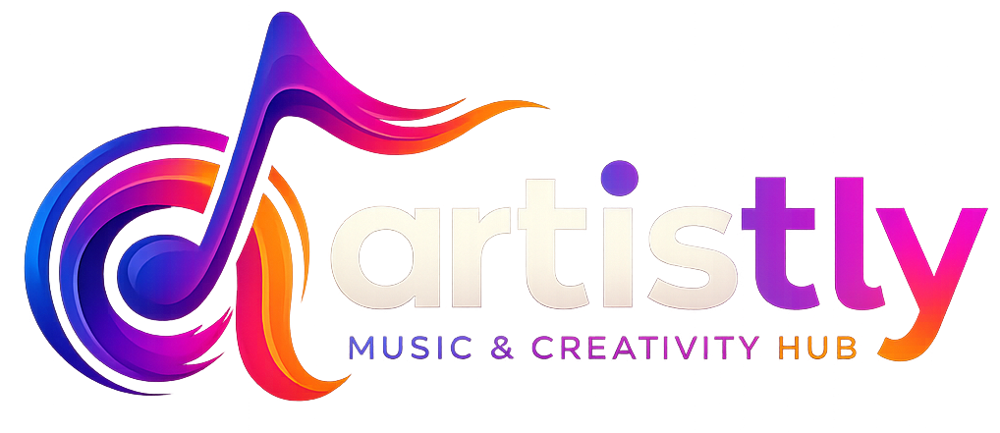
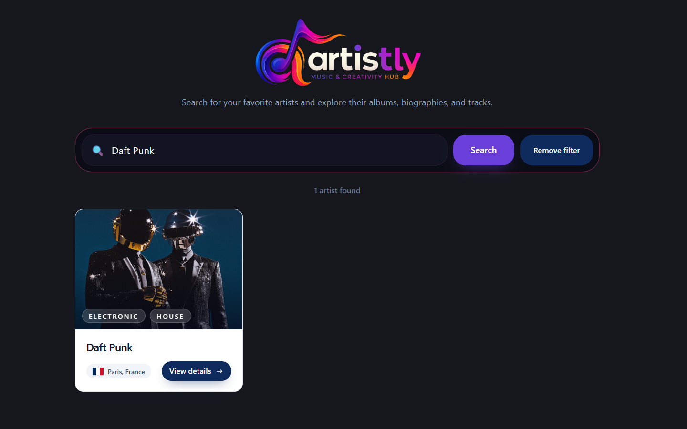
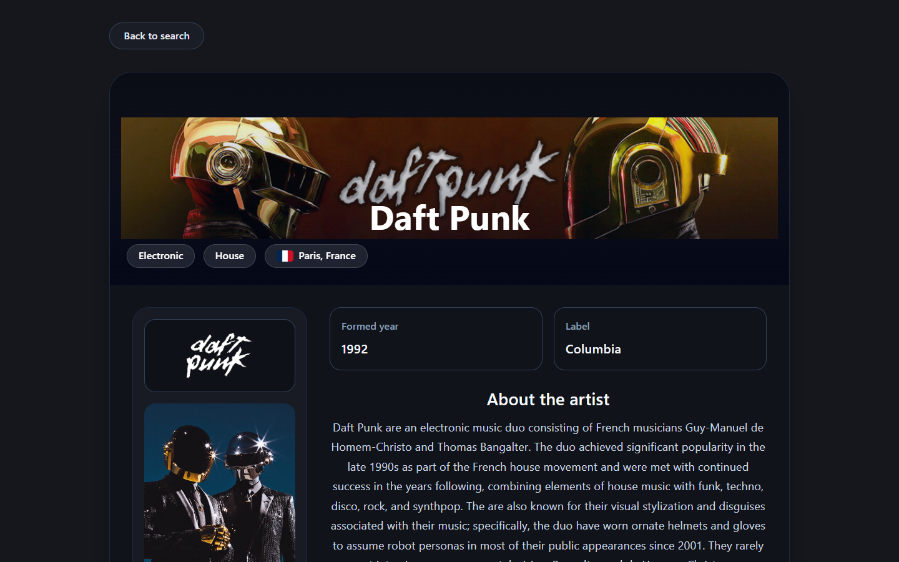
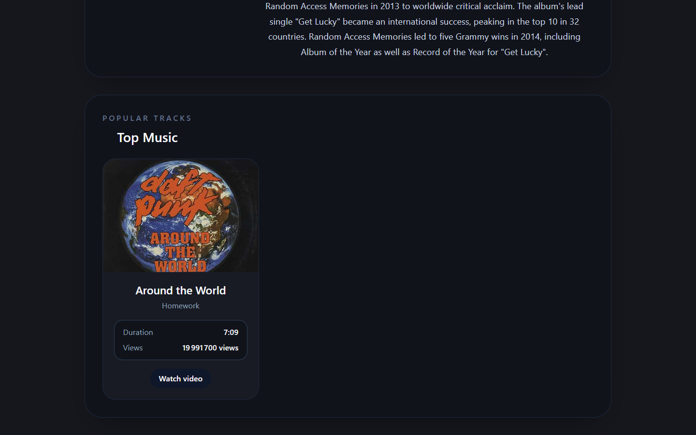
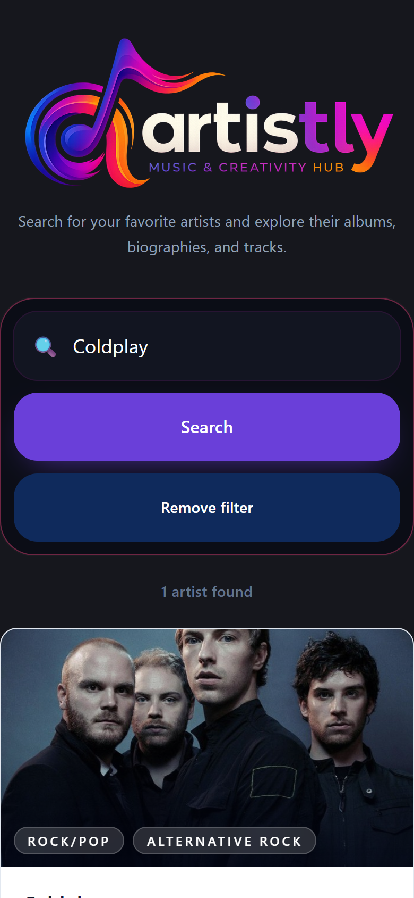
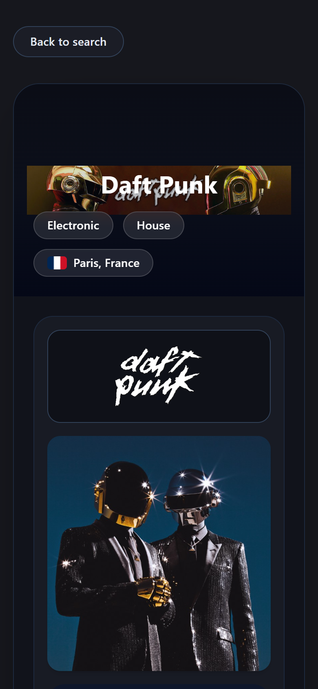

<div align="center">



**Search any music artist and dive into their story, images and most popular tracks.**

A fast single-page React app built on [TheAudioDB](https://www.theaudiodb.com/): type a name, browse the results, then open a rich detail page with the artist's biography, banner, logo, key facts and top tracks.

[Features](#features) · [Tech stack](#tech-stack) · [Getting started](#getting-started) · [Project structure](#project-structure)


[](LICENSE)

</div>

<p align="center">
  
  
</p>

<p align="center">
  
  
  
</p>

## Features

- **Artist search**: type a name and press **Enter** or **Search**; **Remove filter** clears the results.
- **Result cards** with the artist's photo, genre and style tags, and country with its flag.
- **Artist page** (`/artist/:id`): banner, logo, profile picture, biography, genre, style, country, record label and year formed, plus a link to the artist's Last.fm chart when available.
- **Popular tracks**: album cover, track and album name, duration, video views and a **Watch video** button when a music video exists.
- **Graceful states**: loading, empty and error messages everywhere, placeholders for missing images, and a dedicated 404 page.
- **Responsive**: the layout adapts from a large screen down to a phone.

## Tech stack

| Area | Choice |
| --- | --- |
| UI | React 19, TypeScript 6 (strict), Tailwind CSS 4 |
| Routing | React Router 7 (`/`, `/artist/:id`, 404) |
| Build | Vite 8 |
| Data | TheAudioDB REST API (`search.php`, `artist.php`, `track-top10.php`) |
| Quality | ESLint 10 with the React Hooks rules |

### Implementation notes

- **Typed API layer**: every TheAudioDB response is described in `src/types/artist.ts`, and all calls go through `src/api/artistApi.ts`, so pages never build URLs themselves.
- **No stale results**: the detail page loads the artist and then its top tracks in effects that cancel themselves when you navigate away, so a slow response can never overwrite the artist you are now looking at.
- **Safe external links**: URLs coming from the API (music videos, Last.fm) are only turned into links when they use `http` or `https` (`src/utils/safeUrl.ts`).
- **Small reusable components**: `SearchBar`, `ArtistCard`, `CountryBadge`, `StatusMessage` and `TopTrackCard` keep the two pages short and readable.

## Getting started

Requires Node.js 20.19 or newer.

```bash
git clone https://github.com/Nathan-Part/Artistly.git
cd Artistly
npm install
cp .env.example .env
npm run dev
```

Then open http://localhost:5173.

The `.env` file holds the API base URL. The value in `.env.example` uses TheAudioDB's free public test key (`123`); replace it with your own key if you have a premium account:

```env
VITE_API_URL=https://www.theaudiodb.com/api/v1/json/123
```

| Script | Description |
| --- | --- |
| `npm run dev` | Start the development server |
| `npm run build` | Type-check and build for production into `dist/` |
| `npm run preview` | Serve the production build locally |
| `npm run lint` | Run ESLint |

## Project structure

```
src/
├── api/artistApi.ts      # TheAudioDB calls (search, artist details, top tracks)
├── components/           # SearchBar, ArtistCard, CountryBadge, StatusMessage, TopTrackCard
├── pages/                # SearchPage, ArtistDetailPage, NotFoundPage
├── routes/AppRouter.tsx  # Route definitions
├── types/artist.ts       # API response types
├── utils/safeUrl.ts      # http(s)-only link helper
└── assets/               # Logo and images
```

## License

[MIT](LICENSE) © Nathan-Part
